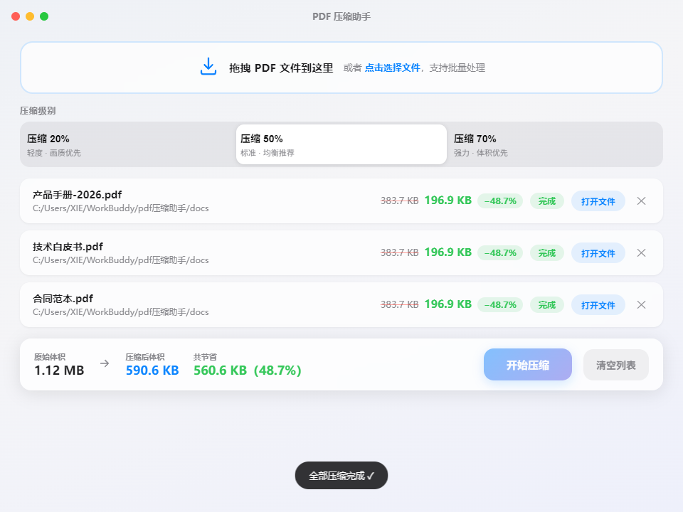

<div align="center">

# 📄 PDF 压缩助手

**极简 · 苹果风格 · 批量 PDF 压缩工具（Windows）**

拖拽即用 · 三档目标压缩率 · 完全本地处理 · 文件不出电脑




</div>

---

## ✨ 特性

- 🖱️ **批量拖拽**：整批拖入或点击选择，自动去重、自动过滤非 PDF 文件
- 🎚️ **三档目标压缩率**：轻度 20% / 标准 50% / 强力 70%，按需选择
- ✍️ **文字保清晰**：分辨率 200dpi 底线 + JPEG 高质量区间，压缩只改体积、不让文字发虚
- 🤖 **自适应压缩**：每个文件自动搜索最合适的参数，实际压缩率精准贴近目标（详见[工作原理](#-工作原理)）
- 🌓 **自动灰度优化**：黑字白底扫描件自动转灰度存储，视觉零差异、体积大幅缩小
- 🛡️ **画质保护**：画质底线内压不动的文件（如纯文字 PDF）自动识别为「已是最佳体积」，绝不强行硬压
- 📊 **体积对比**：单文件压缩前后对比 + 总体积节省统计，一目了然
- 📂 **整理输出**：默认在原文件所在目录自动建立「压缩后」文件夹，输出**与原文件同名**的压缩结果，原始文件不动；目标已存在时自动追加序号，绝不覆盖已有文件
- 📁 **自定义输出文件夹**：也可一键指定统一输出位置，所有压缩结果集中到一个文件夹，选择会被记住
- 🔒 **完全本地**：基于本地 Ghostscript 引擎，无网络请求，文件不出电脑
- 🍎 **苹果风格界面**：无边框窗口、毛玻璃质感、细腻动效

## 📦 下载安装

前往 [Releases](../../releases/latest) 下载最新版安装包。

安装包约 96MB，为便于分发被切成 3 个分片。把以下文件下载到**同一文件夹**，然后双击 `merge-and-install.bat` 即可自动合并并启动安装：

```
PDF-Compressor-Setup-1.3.0.exe.part.aa   32 MB
PDF-Compressor-Setup-1.3.0.exe.part.ab   32 MB
PDF-Compressor-Setup-1.3.0.exe.part.ac   31.6 MB
merge-and-install.bat                    741 B
```

也可手动合并（在该文件夹打开命令提示符）：

```
copy /b PDF-Compressor-Setup-1.3.0.exe.part.aa+PDF-Compressor-Setup-1.3.0.exe.part.ab+PDF-Compressor-Setup-1.3.0.exe.part.ac PDF-Compressor-Setup-1.3.0.exe
```

合并后的安装包 SHA256 为 `9bff5ffdad472f6920e642b8619bc541080c98b1a2d981ff7efcb226488db4ce`，可用 `certutil -hashfile` 校验。

- 自动创建桌面与开始菜单快捷方式
- 应用未做数字签名，首次运行如遇 SmartScreen 提示，点击「更多信息 → 仍要运行」
- 内置 Ghostscript 引擎，无需额外安装任何依赖

> 系统要求：Windows 10 / 11（64 位）

## 🚀 使用方法

1. 把 PDF 文件拖进窗口（或点击选择文件）
2. 选择压缩级别：**压缩 20%**（画质优先）/ **压缩 50%**（均衡推荐）/ **压缩 70%**（体积优先）
3. （可选）在「输出位置」中选择：**原文件旁「压缩后」文件夹**（默认）或**自定义文件夹**（全部结果集中输出，选择自动记忆）
4. 点击「开始压缩」
5. 压缩完成后，以**与原文件相同的名字**输出到所选位置（不改动原文件）；点击「打开文件」可直接定位

## ⚙️ 工作原理

**文字清晰度永远优先于体积。** 引擎设置了硬性画质底线：任何档位都不会把文字压到 **200dpi** 以下，JPEG 重编码始终保持在**视觉高质量区间**（QFactor ≤ 0.4），黑白扫描件固定按 400dpi 处理。在此基础上，用 **「校准阶梯 + 二分搜索」** 自适应逼近目标压缩率：

1. 首档为**结构无损优化**：完全不碰图像，只做字体子集化、重复对象去重、内容流压缩
2. 内置 8 级由温和到激进的压缩阶梯（图像重采样分辨率 + JPEG 质量），全部位于画质底线之内
3. 对每个文件按二分法试压 3~5 次，找到实际压缩率最接近目标的方案
4. **自动灰度优化**：检测到黑字白底的扫描件时，自动转为灰度存储——视觉零差异、体积大幅缩小
5. 若在画质底线内无法达标（如已是 200dpi 的文档、纯矢量文字 PDF），按实际效果输出并标记「已是最佳体积」，**绝不硬压**

压缩引擎为本地 [Ghostscript](https://ghostscript.com)（`pdfwrite` 设备），仅对图像做双三次降采样与 JPEG 重编码，矢量文字内容始终不受影响。

## 🛠️ 从源码构建

```bash
# 1. 克隆仓库
git clone https://github.com/xiezhongjie0220-maker/pdf-compressor.git
cd pdf-compressor

# 2. 安装依赖
npm install

# 3. 下载 Ghostscript 引擎（仅首次，约 65MB）
powershell -ExecutionPolicy Bypass -File scripts/setup-ghostscript.ps1

# 4. 开发运行
npm start

# 5. 打包安装程序（输出到 dist/）
npm run dist
```

> `resources/ghostscript/` 不随仓库分发（体积原因），构建前请先运行步骤 3 的脚本。

## 📁 项目结构

```
├── main.js               # Electron 主进程：窗口、IPC、文件对话框
├── compressor.js         # 压缩引擎：Ghostscript 封装 + 自适应目标压缩率搜索
├── preload.js            # 预加载脚本（contextBridge 安全桥接）
├── renderer/             # 渲染进程（原生 HTML/CSS/JS，苹果风格 UI）
│   ├── index.html
│   ├── styles.css
│   └── app.js
├── scripts/
│   └── setup-ghostscript.ps1   # Ghostscript 下载与解包脚本
└── resources/
    ├── icon.ico / icon.png     # 应用图标
    └── ghostscript/            # 引擎目录（构建时生成，不入库）
```

## 🔒 隐私说明

所有压缩均在本地完成，应用不会发起任何网络请求，不会上传任何文件。

## 📄 许可证

- 本项目代码基于 [MIT License](LICENSE) 开源
- 内置的 [Ghostscript](https://github.com/ArtifexSoftware/ghostpdl-downloads) 基于 **AGPLv3** 协议分发，本工具通过命令行方式独立调用该程序。如需分发包含 Ghostscript 的安装包，请遵循 AGPLv3 的相关要求
